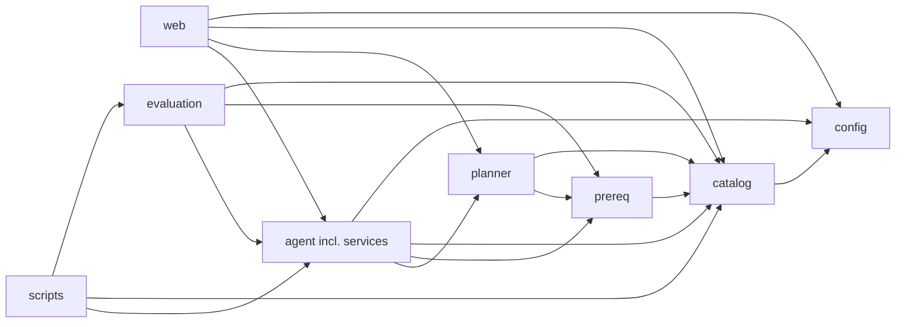
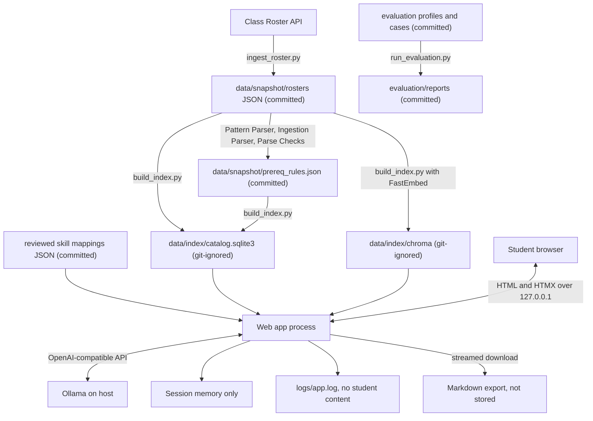

# Component Dependencies

**Stage**: INCEPTION - Application Design

## Module Import Rules (from `docs/technical-environment.md`, binding)

| Module | May import | Must never import |
|---|---|---|
| `config` | none | everything else |
| `catalog` | `config` | `agent`, `langchain_*`, `langgraph`, `openai` |
| `prereq` | `catalog` (read only) | `agent`, `langchain_*`, `langgraph`, `openai`, `planner` |
| `planner` | `prereq`, `catalog` | `agent`, `langchain_*`, `langgraph`, `openai` |
| `agent` | `catalog`, `prereq`, `planner`, `config` | `web`, `evaluation` |
| `web` | `agent`, `planner`, `catalog`, `config` | `evaluation` |
| `evaluation` | all modules | — |

These rules are checked in CI with an import-linting test (to be specified in NFR Design).

## Module Dependency Graph

**Text alternative**: `config` depends on nothing. `catalog` depends on `config`. `prereq` depends on `catalog`. `planner` depends on `prereq` and `catalog`. `agent` (including the service layer) depends on `planner`, `prereq`, `catalog`, and `config`. `web` depends on `agent`, `planner`, `catalog`, and `config`. `evaluation` may depend on all modules. `scripts` connect `agent` (Ingestion Parser), `catalog` (Roster Client, Index Builder), and `evaluation`. Arrows point from the user of a module to the module it uses. No arrow points into `web` or `evaluation`, and none points from the deterministic core to `agent`.

## Component Dependency Matrix

Rows use columns. "R" = reads data from, "C" = calls.

| Component (row) uses → | Settings | Catalog Store | Course Codes | Hybrid Search | Grounding | Rule Model | Evaluator | Chain / Checklist | Offering & Credit | Validator | Fixer | Ranker | Plan Editor | LLM Gateway | Skill Mapper | Tools | Graph | Services | Sessions |
|---|---|---|---|---|---|---|---|---|---|---|---|---|---|---|---|---|---|---|---|
| Index Builder | R | | C | | | R | | | | | | | | | | | | | |
| Hybrid Search | R | R | | | | | | | | | | | | | | | | | |
| Grounding Check | | R | C | | | | | | | | | | | | | | | | |
| Parse Checks | | R | C | | | R | | | | | | | | | | | | | |
| Evaluator | | | | | | R | | | | | | | | | | | | | |
| Chain / Checklist Builder | | R | C | | | R | C | | | | | | | | | | | | |
| Plan Validator | | R | | | | | C | | C | | | | | | | | | | |
| Plan Fixer | | R | | | | | C | | C | C | | | | | | | | | |
| Ranker | | R | | | | | C | | | | | | | | | | | | |
| Plan Editor | | | C | | | | | | C | | | | | | | | | | |
| LLM Gateway | R | | | | | | | | | | | | | | | | | | |
| Skill Mapper | | | | | | | | | | | | | | C | | | | | |
| Ingestion Parser | | | | | | R | | | | | | | | C | | | | | |
| Agent Tools | | R | | C | | | C | C | | C | | | | | | | | | |
| Planning Graph | | | | C | C | | C | | | C | C | C | C | C | C | C | | | |
| Services | R | R | C | | C | | C | C | | C | C | | C | | C | | C | | |
| Routes | R | | | | | | | | | | | | | | | | | C | C |
| Health Checks | R | R | | R | | | | | | | | | | C | | | | | |
| Evaluation Runner | | R | | | | R | C | | | C | | | | | | | | C | |

## Communication Patterns
- **In-process function calls only.** One process, synchronous request and response from the route's point of view; the LLM and FastEmbed calls are awaited inside the service (technical environment: Messaging and Events, not applicable).
- **Outbound network calls**: only the LLM Gateway (to Ollama on the host, or a hosted endpoint over HTTPS) and the Roster Client (Class Roster API, ingestion only). URLs come only from Settings and the fixed roster base URL (A10 SSRF).
- **Data at runtime is read only**: SQLite and Chroma are opened read-only by the web app. Only the scripts write them.
- **State**: student state lives only in the Session Store and in LangGraph's `InMemorySaver`, both keyed by session ID.

## Data Flow

**Text alternative**: Ingestion turns Class Roster responses into committed raw JSON and committed parsed rules. The index build turns those into a git-ignored SQLite database and Chroma index. At runtime the web app reads SQLite, Chroma, and the committed reviewed skill mappings; talks to the browser over localhost and to Ollama on the host; keeps student data only in memory; writes logs without student content; and streams exports without saving them. The evaluation script reads committed cases and writes committed reports.

## Notes for Units Generation
- **Build order by dependency**: `config` and `catalog` (C1 to C8) first, because almost every story needs course data. Then `prereq` and `planner` (deterministic, testable without a model, can run in parallel with the agent work once the models C9 and C15 are fixed). Then `agent` and services. `web` can start early against fake services, because its interface is the service signatures.
- **Shared contracts to freeze early**: Rule Model (C9), Planning Models (C15), Verdict (C12), and the service signatures. Changes to these affect several owners.
