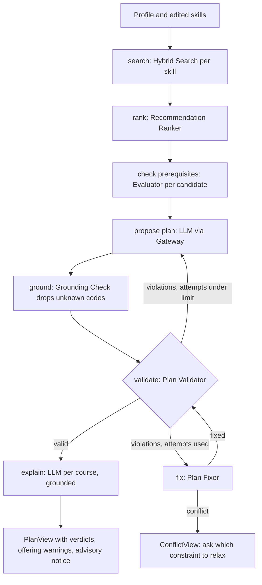
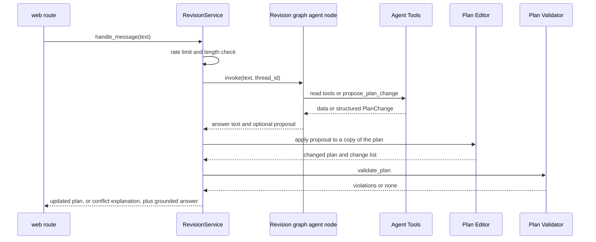
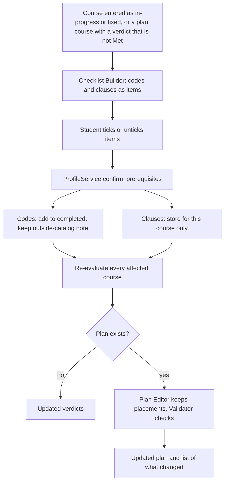

# Services

**Stage**: INCEPTION - Application Design

The service layer lives in `agent/services/` (C27). It is the only entry point for student tasks. `web` routes call it with the session's state, and the `evaluation` runner calls the same methods in process (B10:A). Services own the order of the safety steps, so no route or agent node can skip them:

> **Every LLM-derived output passes C8 Grounding Check. Every plan passes C17 Plan Validator before it is returned (FR-4.5, FR-6.7, NFR-4.8).**

Services take and return Pydantic models. They never write student data to disk or logs (FR-1.7, NFR-4.2).

---

## Service Catalog

| Service | Methods | Stories |
|---|---|---|
| **ProfileService** | `update_profile`, `set_courses`, `set_constraints`, `get_checklist`, `confirm_prerequisites`, `list_confirmed` | US-1.1 to US-1.4 |
| **CareerService** | `submit_goal`, `edit_skills`, `compare` | US-2.1 to US-2.4 |
| **PlanningService** | `create_plan`, `resolve_conflict`, `prerequisite_chain`, `verdicts_for` | US-3.1, US-4.1, US-5.1 to US-5.3, US-6.1 to US-6.3, US-9.1 |
| **RevisionService** | `handle_message` | US-7.1 to US-7.4 |
| **ExportService** | `export_markdown` | US-8.1 |
| **HealthService** | `shallow`, `deep`, `startup_check` | US-11.3, US-10.4 |
| **IngestionService** (scripts only) | `ingest_rosters`, `parse_rules`, `build_index` | US-10.1 |
| **EvaluationService** (scripts only) | `run_evaluation` (C34) | US-10.2, US-10.3 |

### Signatures
```python
class ProfileService:
    def update_profile(self, s: SessionState, form: ProfileForm) -> ProfileView: ...
    def set_courses(self, s: SessionState, completed: str, in_progress: str) -> CoursesView: ...
    def set_constraints(self, s: SessionState, form: ConstraintsForm) -> ConstraintsView: ...
    def get_checklist(self, s: SessionState, code: CourseCode) -> ChecklistView: ...
    def confirm_prerequisites(self, s: SessionState, code: CourseCode,
                              checked: list[str], unchecked: list[str]) -> RecheckView: ...   # CR-1
    def list_confirmed(self, s: SessionState) -> ConfirmedView: ...

class CareerService:
    async def submit_goal(self, s: SessionState, goal: str) -> GoalView: ...      # skills or follow-up questions
    def edit_skills(self, s: SessionState, form: SkillEditForm) -> SkillsView: ...
    async def compare(self, s: SessionState, careers: list[str]) -> ComparisonView: ...

class PlanningService:
    async def create_plan(self, s: SessionState) -> PlanView | ConflictView: ...
    async def resolve_conflict(self, s: SessionState, choice: RelaxChoice) -> PlanView | ConflictView: ...
    def prerequisite_chain(self, s: SessionState, code: CourseCode) -> ChainView: ...
    def verdicts_for(self, s: SessionState, codes: list[CourseCode]) -> dict[CourseCode, Verdict]: ...

class RevisionService:
    async def handle_message(self, s: SessionState, session_id: str, text: str) -> RevisionView: ...

class ExportService:
    def export_markdown(self, s: SessionState) -> Iterator[str]: ...             # streamed, never saved

class HealthService:
    def shallow(self) -> dict[str, str]: ...
    async def deep(self) -> DeepHealth: ...                                       # Ollama, SQLite, Chroma, embedding match
    def startup_check(self) -> None: ...                                          # raises on embedding mismatch
```

---

## Flow 1: First Plan (PlanningService.create_plan)

Runs the fixed nodes of C26 Planning Graph (B2:C). The 90-second target applies here (NFR-1.1). Checklists are not part of this flow (C1:A).



**Text alternative**
1. Search the catalog for each skill (keyword plus vector, merged), filtered by level.
2. Rank the candidates deterministically (skill coverage plus reachability, minus avoided topics).
3. Evaluate prerequisites for each candidate.
4. The LLM proposes a placement (structured output).
5. The Grounding Check removes any code not in the snapshot.
6. The Validator checks the plan. If it fails and retry attempts remain, the errors go back to step 4. When attempts are used up, the Fixer repairs the plan, which is then validated again.
7. If the Fixer reports a conflict, the student is asked which constraint to relax (FR-6.6); `resolve_conflict` re-enters at step 4.
8. A valid plan gets a short explanation per course (grounded), then the plan view is returned.

---

## Flow 2: Chat Revision (RevisionService.handle_message)

Uses the agent node of C26 with `InMemorySaver` (`thread_id` = session ID). The agent can only read and propose (B3:A, B4:A, LLM06).



**Text alternative**
1. The route checks the CSRF token, rate limit (10 per minute), and length (2,000 characters).
2. The agent node reads data through tools, and may return a `PlanChange` or `ProfileChange` proposal.
3. "Why" questions return only an answer; the plan does not change (US-7.2).
4. A `ProfileChange` is applied only if the student stated it explicitly; otherwise the service asks for confirmation (FR-7.3).
5. The Plan Editor applies a proposal to a copy of the plan, keeping unaffected courses in place (FR-7.4).
6. The Validator checks the copy. If it fails, the Fixer runs; an unfixable result is explained and the old plan is kept.
7. "Start over" re-runs Flow 1 with the same profile and skills (FR-7.5).
8. The answer text passes the Grounding Check before display.

---

## Flow 3: Prerequisite Checklist (CR-1)

`ProfileService.get_checklist` and `confirm_prerequisites`. No LLM call.



**Text alternative**
1. A checklist is offered for in-progress and fixed courses, and, after the first plan, for courses whose verdict is not Met.
2. The Checklist Builder lists each course code and each clause. For an unverified rule, it lists only the codes found in the text.
3. Ticked codes are added to completed courses (including codes outside the loaded catalog, with a note). Ticked clauses are stored for that course only.
4. Every course whose rule mentions an affected code, or the affected course itself for clauses, is re-evaluated.
5. If a plan exists, placements are re-checked incrementally and validated; the student sees what changed.
6. Removing an item from "Prerequisites I've confirmed" runs the same flow in reverse.

---

## Flow 4: Ingestion and Index Build (scripts)

1. `scripts/ingest_roster.py`: Roster Client fetches the 8 core subjects for 4 years of terms (resumable, at most 1 request per second) and writes raw JSON through the Snapshot Store.
2. Same script: each prerequisite text goes to the Pattern Parser. Text it can't parse goes to the Ingestion Parser (two LLM parses), then to Parse Checks. Results are written to `prereq_rules.json` with `verified` status.
3. `scripts/build_index.py`: Index Builder creates SQLite, FTS5, and the Chroma collection from the snapshot and prints a summary.

## Flow 5: Evaluation (scripts)

`scripts/run_evaluation.py` loads cases (C33), runs each profile through `PlanningService.create_plan` in process, runs each prerequisite case through the Evaluator, and writes the dated report (C34).

---

## Cross-Cutting Service Rules
- **Errors**: a failed LLM call after 3 attempts raises a typed error. The service keeps session state unchanged, and the route renders the generic error fragment (NFR-3.1).
- **Logging**: services log event names, durations, tool names, retries, validation failures, and fabrication events only. No profile content, chat text, or goals (NFR-4.2).
- **Session isolation**: a service only receives the `SessionState` that the route got from the caller's cookie.
