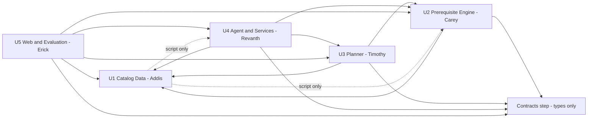

# Unit of Work Dependencies

**Stage**: INCEPTION - Units Generation

## Dependency Matrix

Rows depend on columns. **B** = build-time dependency (imports the unit's code). **S** = script-level only (a script in the row unit calls the column unit; the module code does not import it). **F** = can be faked until the column unit is ready (Q8:A).

| Unit (row) depends on → | U1 Catalog Data | U2 Prerequisite Engine | U3 Planner | U4 Agent and Services | U5 Web and Evaluation |
|---|---|---|---|---|---|
| **U1 Catalog Data** | — | S (pattern parser, parse checks in `ingest_roster.py`) | | S (Ingestion Parser in `ingest_roster.py`) | |
| **U2 Prerequisite Engine** | B (`CatalogStore`, course codes, fixture catalog) | — | | | |
| **U3 Planner** | B (`CatalogStore`, fixture catalog) | B (`evaluate`, `Verdict`, `build_chain`) | — | | |
| **U4 Agent and Services** | B (search, catalog, grounding, settings) | B (evaluator, chain, checklist, rule model) | B (models, validator, fixer, ranker, editor) | — | |
| **U5 Web and Evaluation** | B (settings, catalog for health) | B (evaluator, for the 40 prerequisite cases) | B (`StudentProfile`, `Plan` for templates) | B, **F** (service signatures; fake services until wave 2) | — |

## Unit Dependency Graph

**Text alternative**: Solid arrows point from a unit to a unit whose code it imports. U2 imports U1. U3 imports U2 and U1. U4 imports U3, U2, and U1. U5 imports U4, U3, U2, and U1. The dashed arrows are script-level only: U1's `ingest_roster.py` calls U2's parser and checks and U4's Ingestion Parser, but U1's module code imports neither. U2 to U5 all build against the shared contracts (types only) written in the contracts step.

## Cycle Check
- **Module level (imports)**: U1 → U2 → U3 → U4 → U5 is a strict order; no unit imports a unit to its right. No cycle.
- **Script level**: `ingest_roster.py` lives in `scripts/`, which may import any module. It is the only place U1 work touches U2 and U4. This does not create an import cycle, but it creates a **schedule dependency**: the LLM-parsed half of `prereq_rules.json` needs U2's Parse Checks and U4's Ingestion Parser.
  - **Mitigation**: in wave 1, U1 commits the snapshot with pattern-parsed rules, and marks text the pattern parser can't handle as pending. In wave 2, the pending rules are parsed by the LLM and checked. Until then, evaluator tests use the fixture catalog's hand-checked rules.

## Integration Points and What Can Be Faked

| Interface | Provider | Consumers | Frozen in contracts step | Fake until ready |
|---|---|---|---|---|
| `Rule`, `StoredRule`, `Verdict`, `Status` | U2 | U1 (scripts), U3, U4, U5 | Yes | Not needed (types only) |
| `StudentProfile`, `Plan`, `PlanChange`, `ProfileChange` | U3 | U4, U5 | Yes | Not needed (types only) |
| Service signatures and view models (C27) | U4 | U5 (web, evaluation) | Yes | **Yes**: U5 fake services return fixture-based views (Q8:A) |
| `CatalogStore`, `HybridSearch` | U1 | U2, U3, U4 | Signatures in `component-methods.md` | Fixture catalog from U1 in week 1 (Q9:A) |
| LLM Gateway | U4 | U4 only (plus U1 script) | No (internal to U4) | Fake chat model in tests (technical environment mocking policy) |

## Integration Checkpoints
1. **End of contracts step**: all units compile against the shared types (mypy passes).
2. **End of wave 1**: U1 to U3 pass their unit and property tests on the fixture catalog; U5 shell passes route tests against fake services.
3. **Mid wave 2**: U4 services run the first-plan flow on the real U1 to U3 code with a fake chat model.
4. **End of wave 2**: U5 uses the real services; both MVP journeys run end to end; the evaluation runner produces its first report.
