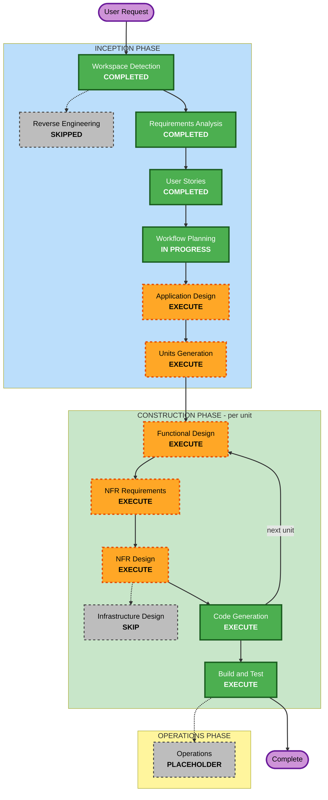

# Execution Plan: Cornell AI Course Planning Agent

**Stage**: INCEPTION - Workflow Planning
**Inputs**: `requirements.md` (approved), `stories.md` and `personas.md` (approved), `docs/vision.md`
**Date**: 2026-11-24
**Hard deadline**: 2026-12-16
**Status**: Approved 2026-11-24. The team is completing Inception only for now; the Construction stages below are provisional and will be reviewed before Construction starts.

---

## Detailed Analysis Summary

### Transformation Scope
N/A: greenfield project, no existing code.

### Change Impact Assessment
| Area | Impact | Description |
|---|---|---|
| User-facing changes | Yes | A new web app: profile intake, career and skill mapping, recommendations, prerequisite verdicts, semester plan, chat revision, export (29 stories, E1 to E11) |
| Structural changes | Yes | The whole architecture is new. Candidate components: catalog ingestion, search index, prerequisite parser and evaluator, career and skill mapper, recommender, LLM agent and tools, plan validator and fixer, session store, web UI, evaluation harness |
| Data model changes | Yes | New models: catalog snapshot, parsed prerequisite rule (with verified/unverified status), student profile (session only), skill mapping cache, plan, evaluation cases |
| API changes | Yes | New internal interfaces: the agent's tool contracts, the HTTP routes of the server-rendered app, the health checks, and the evaluation command |
| NFR impact | Yes | 90-second first plan on a local model (NFR-1.1); accuracy targets (NFR-2); Security and Resiliency baselines; full property-based testing; WCAG 2.1 AA |

### Risk Assessment
| Item | Value | Reason |
|---|---|---|
| Risk level | **High** | Local LLM speed and tool-calling quality are unproven (requirements section 7 assumption); free-text prerequisite parsing; 22 days to the deadline with Construction not started |
| Rollback complexity | Easy | Local app with no deployment; rollback is `git revert` (CQ15) |
| Testing complexity | Complex | Non-deterministic LLM output, plus property-based tests on the deterministic components, plus a 10-profile and 40-case evaluation harness |

**Main mitigation built into this plan**: measure local model speed and tool-calling early (in the first Code Generation unit, see Units Generation guidance below), so that work can move into deterministic code in time if the model falls short.

---

## Workflow Visualization



### Text Alternative
```
INCEPTION PHASE
- Workspace Detection ......... COMPLETED
- Reverse Engineering ......... SKIPPED (greenfield)
- Requirements Analysis ....... COMPLETED
- User Stories ................ COMPLETED
- Workflow Planning ........... IN PROGRESS
- Application Design .......... EXECUTE
- Units Generation ............ EXECUTE

CONSTRUCTION PHASE (repeat for each unit)
- Functional Design ........... EXECUTE (units with business logic)
- NFR Requirements ............ EXECUTE
- NFR Design .................. EXECUTE
- Infrastructure Design ....... SKIP
- Code Generation ............. EXECUTE (always)
then, after all units:
- Build and Test .............. EXECUTE (always)

OPERATIONS PHASE
- Operations .................. PLACEHOLDER
```

---

## Phases to Execute

### INCEPTION PHASE
- [x] Workspace Detection (COMPLETED)
- [x] Reverse Engineering (SKIPPED: greenfield, no code to analyze)
- [x] Requirements Analysis (COMPLETED, comprehensive depth)
- [x] User Stories (COMPLETED: 5 personas, 29 stories)
- [x] Workflow Planning (COMPLETED, approved)
- [ ] Application Design - **EXECUTE**
  - **Rationale**: The system is all new components. Component boundaries, the agent's tool contracts, the split between deterministic code and LLM code (NFR-7.1), and dependencies between components all need defining. Resiliency rule RESILIENCY-01 (workload criticality per component) was deferred to this stage.
  - **Owner**: Member 4 (technical environment and application design)
- [ ] Units Generation - **EXECUTE**
  - **Rationale**: Five members each own one or more units (CQ12:A). The 29 stories need grouping into units with a build order. The Construction split was explicitly left to this stage (Q39 covered only Inception roles).
  - **Owner**: Member 5 (units of work and QA)

### CONSTRUCTION PHASE (per unit)
- [ ] Functional Design - **EXECUTE** for units with business logic; may be skipped for a unit with none (decided per unit)
  - **Rationale**: New data models (snapshot, prerequisite rule, plan) and complex rules: prerequisite parsing and evaluation, the default "and/or" reading, offering-term rules, credit limits, ranking, the propose, validate, retry and fix loop. Property-based testing (full) needs the properties identified here (PBT-01).
- [ ] NFR Requirements - **EXECUTE**
  - **Rationale**: Performance target (NFR-1.1), accuracy targets (NFR-2), Security and Resiliency baselines, the PBT framework decision (PBT-09, expected Hypothesis), and model and library choices. RESILIENCY-04 (deployment and rollback questions) was deferred to this stage.
- [ ] NFR Design - **EXECUTE**
  - **Rationale**: NFR patterns must be designed in: timeouts and retries, health checks, structured logging without student data, input validation, security headers, rate limiting, and fabrication checks. RESILIENCY-14 (resiliency testing question) was deferred to this stage.
- [ ] Infrastructure Design - **SKIP**
  - **Rationale**: No cloud or hosted infrastructure. The app is a local Docker container reaching a native model runtime over localhost (Q6:C, CQ3:A), with no deployment (CQ14). The Dockerfile, configuration, and `.env.example` are produced in Code Generation, and setup is covered in Build and Test and the README. The team can add this stage if it wants a separate design for the Docker and model-runtime setup.
- [ ] Code Generation - **EXECUTE** (always)
  - **Rationale**: Implementation planning and code for each unit.
- [ ] Build and Test - **EXECUTE** (always)
  - **Rationale**: Build, unit and property-based tests, the two journey tests (NFR-7.3), the evaluation command (FR-10.3), and the student tester sessions (NFR-2.6).

### OPERATIONS PHASE
- [ ] Operations - **PLACEHOLDER**
  - **Rationale**: No deployment; the app is local only.

---

## Change Request CR-1: Prerequisite Checklist Stored in the Profile
**Raised**: 2026-11-24, at Workflow Planning approval
**Request (summary; full text in `audit.md`)**: When the student is taking a class that has prerequisites, the app shows that class's prerequisite list. The student selects the ones they have done, and the selections are stored in their profile. When the planner meets another class with the same prerequisite or corequisite, it already knows the item is checked off.

**Affected artifacts**
| Artifact | Change |
|---|---|
| `requirements.md` | New FR-1.9 (prerequisite checklist) and FR-5.11 (evaluator uses checked-off items); possible change to FR-5.5 and FR-5.7 depending on the answers |
| `stories.md` | New story US-1.4; acceptance criteria added to US-5.1 and US-5.2; coverage table updated |
| Application Design | The profile model gets a "satisfied prerequisites" record; the prerequisite evaluator reads it |

**Handling**: modify existing artifacts (`common/workflow-changes.md`, approach A); no stage restart. Open details are asked in `application-design-plan.md`, section A. Requirements and stories are updated after the answers, and the changes are presented with the Application Design approval.

---

## Guidance for Units Generation
These are recommendations for Member 5, not decisions:
1. **Early risk check first.** The first unit to reach Code Generation should include a minimal call to the local model with one tool and structured output, timed on the team's fastest laptop. This tests the NFR-1.1 and tool-calling assumptions before the agent is built on them.
2. **Catalog snapshot early.** US-10.1 (snapshot and load-time prerequisite parsing) blocks every story that shows courses. It should be in the first unit set.
3. **Deterministic core separate from LLM parts.** The prerequisite evaluator, plan validator, plan fixer, credit arithmetic, and course-code checks (NFR-7.1) can be built and property-tested without a model, in parallel with the agent work.
4. **Export last.** US-8.1 is the only Should Have story and can be dropped if time runs out.

---

## Estimated Timeline

| Window | Dates | Work |
|---|---|---|
| Inception wrap-up | Nov 24 to Nov 28 | Application Design, Units Generation; README, product proposal, technical environment document, vision updates |
| Construction | Nov 29 to Dec 11 | Per-unit Functional Design, NFR Requirements, NFR Design, Code Generation, with units in parallel across the 5 members |
| Build and Test | Dec 11 to Dec 14 | Integration, evaluation runs, student tester sessions, demo video of both journeys |
| Buffer and submission | Dec 15 to Dec 16 | Fixes, final rubric check (Member 5), submission (Member 1) |

- **Stages still to run**: 7 (Application Design, Units Generation, then per unit: Functional Design, NFR Requirements, NFR Design, Code Generation; then Build and Test)
- **Stages skipped**: Reverse Engineering, Infrastructure Design

The Construction window is tight. NFR Requirements and NFR Design can be done once for the whole system, rather than separately for each unit, where the NFRs are shared. This is a choice for Units Generation.

---

## Success Criteria
- **Primary goal**: A working local demo by December 16, 2026 that runs both MVP journeys end to end with validated plans built only from real Cornell courses.
- **Key deliverables**:
  - Working app in the repository, runnable on all 5 laptops from the README (NFR-6.2)
  - Evaluation report from one command (FR-10.3)
  - Demo video of both MVP journeys
  - Complete AI-DLC artifacts (`aidlc-docs/`), with `audit.md` and `aidlc-state.md` maintained
  - README and product proposal, technical environment document, updated vision
- **Quality gates**:
  - 0 fabricated courses across the 10 evaluation profiles (NFR-2.1)
  - At least 90% prerequisite verdict agreement on the 40 cases (NFR-2.2)
  - 100% of plans pass the validator (NFR-2.3)
  - 100% explanation coverage (NFR-2.4)
  - First plan in under 90 seconds on the median profile (NFR-1.1)
  - Property-based and example-based tests pass for all deterministic components (NFR-7.2, NFR-7.3)
  - Extension compliance (Security, Resiliency, PBT) with no blocking findings at each stage gate
